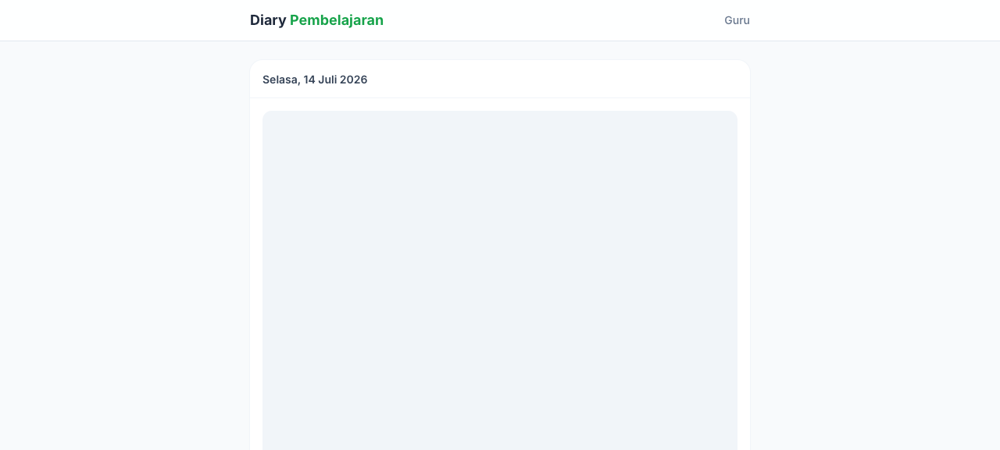

# Diary Pembelajaran

Aplikasi web untuk guru mencatat kegiatan belajar harian (foto + caption) yang bisa dilihat orang tua murid (read-only). Foto disimpan di **Google Drive**, metadata disimpan di **Google Sheets**.

## Tech Stack

- **Frontend**: React + TypeScript (Vite)
- **Styling**: Tailwind CSS
- **Routing**: react-router-dom
- **Image compression**: browser-image-compression (Canvas API)
- **Backend/DB**: Google Apps Script Web App + Google Sheets + Google Drive

## Struktur Folder

```
diary-teachlife/
├─ gs/
│  └─ Code.gs                 # Google Apps Script (REST API)
├─ src/
│  ├─ types/
│  │  └─ diary.ts             # Tipe Diary + konstanta
│  ├─ utils/
│  │  ├─ auth.ts              # Token sesi (localStorage)
│  │  ├─ api.ts               # Client ke Apps Script Web App
│  │  ├─ upload.ts            # Upload foto ke Drive via Apps Script
│  │  └─ imageCompression.ts  # Kompresi foto → Base64 (transport)
│  ├─ components/
│  │  ├─ StatusBadge.tsx      # Badge Draft/Published
│  │  ├─ Spinner.tsx          # Loading
│  │  ├─ PhotoGallery.tsx     # Galeri foto + lightbox
│  │  └─ PreviewModal.tsx     # Preview sebelum publish
│  ├─ pages/
│  │  ├─ LoginPage.tsx        # Login guru
│  │  ├─ DashboardPage.tsx    # Daftar diary per tanggal
│  │  ├─ UploadPage.tsx       # Create/Edit + upload foto ke Drive
│  │  └─ PublicPage.tsx       # Halaman publik orang tua
│  ├─ App.tsx                 # Routing
│  └─ main.tsx
├─ .env.local                 # VITE_API_URL
└─ tailwind.config.js
```

## Skema Google Sheets (sheet `Diary`)

| ID | Date | Photo1_URL | Photo2_URL | Photo3_URL | Caption | Status | CreatedAt | UpdatedAt |
|----|------|------------|------------|------------|---------|--------|-----------|----------|

**Photo1_URL–Photo3_URL**: URL publik Google Drive (`https://drive.google.com/uc?export=view&id=...`). Foto asli disimpan di Drive, bukan di Sheets.

Sheet kedua `Session`: `Token | CreatedAt | ExpiresAt` (token sesi admin, berlaku 24 jam).

## Alur Upload & Penyimpanan Foto

```
User pilih file → Kompresi (max 1024px, 75% kualitas) → Base64
  → POST ke Apps Script (action=uploadPhoto)
    → Base64 decode → Blob → Simpan ke Google Drive folder
    → Set akses "Anyone with link can view"
    → Return URL publik
  → Frontend simpan URL, tampilkan preview
  → Saat submit diary → Kirim URL ke action=create / update
```

## Setup Google Drive Folder

1. Buat folder baru di Google Drive (misal "Diary Photos").
2. Buka folder, salin **ID** dari URL: `https://drive.google.com/drive/folders/PASTE_THIS_ID`
3. Buka Apps Script → `gs/Code.gs` → ganti `DRIVE_FOLDER_ID` dengan ID tersebut.
4. Jalankan fungsi `setup()` dari editor untuk memverifikasi folder & membuat sheet.

## Setup Backend (Google Apps Script)

1. Buat Google Spreadsheet baru.
2. Buat folder Google Drive (lihat di atas), salin ID-nya.
3. Buka **Extensions → Apps Script**, tempel `gs/Code.gs`.
4. Set `ADMIN_USERNAME`, `ADMIN_PASSWORD`, `DRIVE_FOLDER_ID` di **Script Properties** (lihat `docs/deploy.md`).
5. Pilih fungsi `setup` di dropdown → Run (izinkan akses Drive & Sheets).
6. **Deploy → New deployment → Web app**:
   - Execute as: **Me**
   - Who has access: **Anyone**
7. Salin Web App URL → `VITE_API_URL` di `.env.local`.

## Setup Frontend

```bash
npm install
echo "VITE_API_URL=<URL_WEB_APP>" > .env.local
npm run dev
```

Build production: `npm run build`.

## Catatan

- Kredensial admin tidak disimpan di kode — set di Script Properties (`docs/deploy.md`). Jika kosong, backend `login` gagal cepat dengan pesan konfigurasi.
- Foto dihapus otomatis dari Drive saat diary dihapus atau foto diganti.
- Maksimal 3 foto per hari (divalidasi frontend + backend).
- Batas ukuran gambar per foto: 5 MB (diperiksa backend; frontend sudah mengompresi).
- Test: `npm test` (vitest — token kedaluwarsa, batas ukuran gambar, fail-fast kredensial).

## Screenshot



*Halaman publik; foto murid diblokir di screenshot ini demi privasi.*

## Privasi & Akses Foto

Bagaimana foto dapat diakses publik:

| Akses | Mekanisme |
|---|---|
| **Publik (halaman orang tua)** | Hanya diary berstatus `Published` yang muncul di `/` via `publicList` — tanpa login. Foto disajikan lewat endpoint `servePhoto` proxy Apps Script (data URI), jadi file Drive-nya sendiri **tidak perlu** dibagikan ke publik. |
| **Draft/private** | Diary berstatus `Draft` hanya terlihat oleh admin yang login (`adminList`, `getById` memerlukan token valid). Foto draft tetap bisa di-load admin via `servePhoto`, tapi tidak terinduk ke halaman publik. |
| **Permission untuk semua diary lainnya (create, update, delete, upload, delete photo, adminList, getById, setStatus)** | Semua memerlukan token sesi (`requireAuth`); token kedaluwarsa ditolak, seperti dites di `tests/gs-logic.test.mjs`. |

Batas yang perlu diperhatikan:

- `servePhoto` dan `publicList` dapat dipanggil siapa saja; `servePhoto` menerima `fileId` apa pun *jika* fileId-nya diketahui — file foto yang lolos ke drive folder tidak memiliki ACL tambahan. **Karena itu jangan berikan URL/fileId foto sensitif ke halaman publik yang belum dibagikan sengaja.**
- Tidak ada rate limiting; halaman publik memaparkan tanggal + caption + foto yang dipublikasikan.
- Screenshot di README memblokir foto anak untuk privasi — pin rate limit atau watermark dalam pertimbangan berikutnya.
